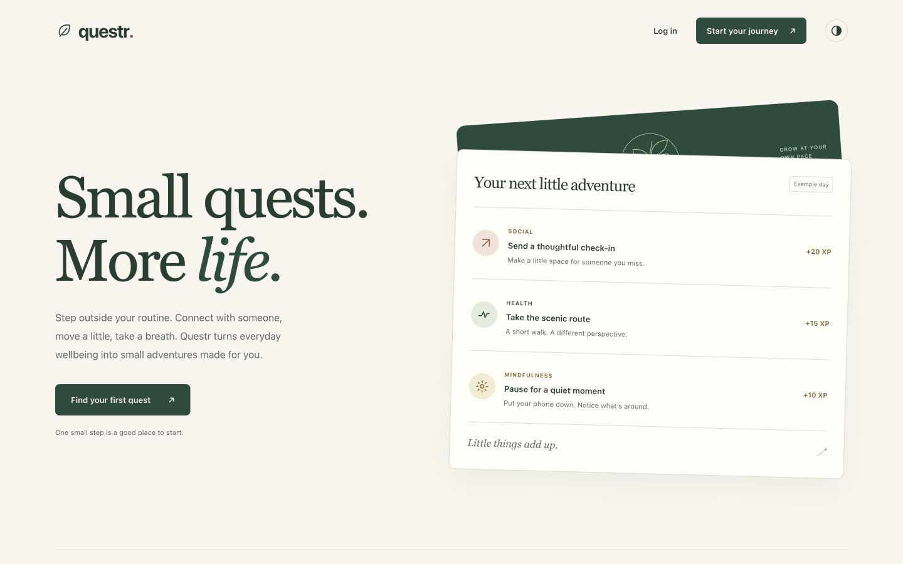
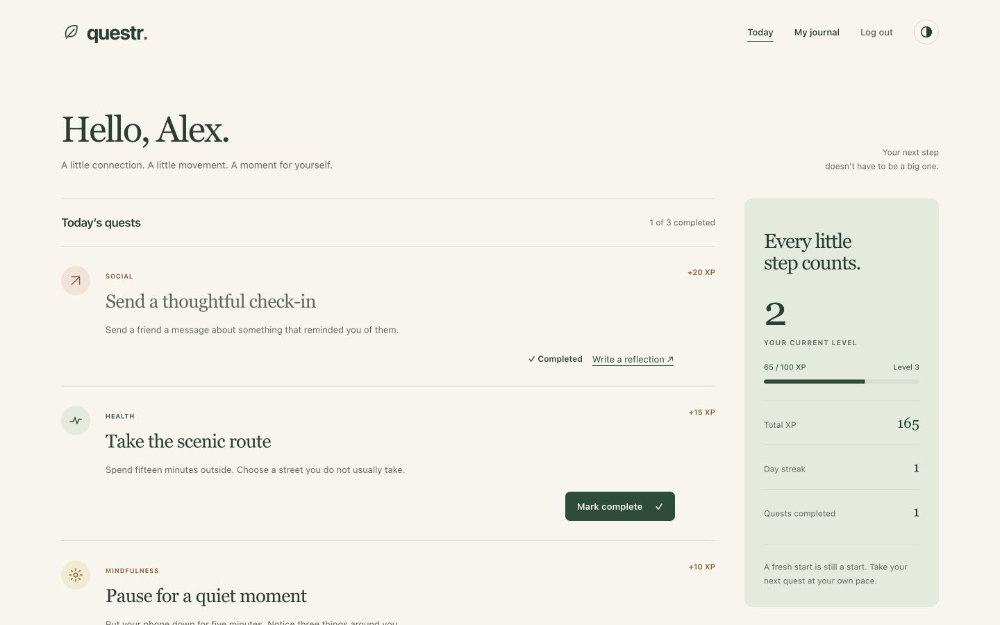
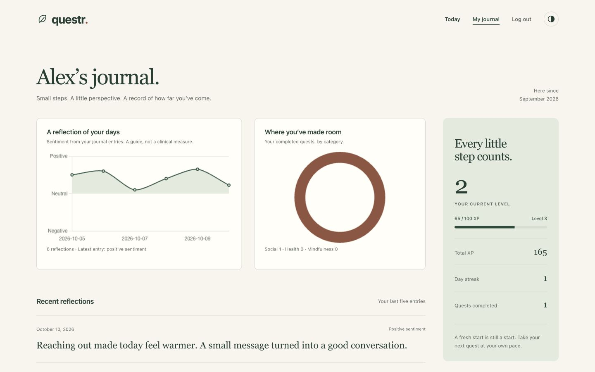

# Questr

A full-stack web application that gives users positive daily tasks to improve mental, physical, and social wellbeing.

## Screenshots

The app screens use a local demo account with sample quests and reflections.

### Landing page

An introduction to small daily quests for health, connection and mindfulness.



### Today’s quests

Daily quest cards with completion, XP and streak information.



### Personal journal

Reflection trends, quest categories, level progress and recent entries.



## Features

### 🏠 Dashboard
- Personalized welcome message
- 3 daily quests (Social, Health, Mindfulness)
- Quest completion tracking with XP rewards
- Current streak counter
- Progress visualization

### 🎮 Quest System
- **Social Quests**: Connect with others through meaningful interactions
- **Health Quests**: Small steps toward better physical health
- **Mindfulness Quests**: Practice mindfulness, gratitude, and mental wellbeing
- Dynamic quest generation with reward points
- Quest completion tracking and streak management

### 📊 Progress Tracking
- XP points and leveling system
- Streak counters with motivational feedback
- Chart.js visualizations for mood trends
- Quest category breakdown charts
- Achievement badges and milestones

### 💭 Mood Reflection
- Post-quest reflection forms
- Sentiment analysis using TextBlob
- Mood tracking over time
- Personalized feedback based on reflections

### 🏆 Achievement System
- Auto-awarded badges for milestones:
  - 5-day streak → "Motivation Master" 
  - 10-day streak → "Streak Champion" 
  - 50 XP → "Level 2 Explorer" 
  - 100 XP → "Quest Veteran" 
  - 10 quests completed → "Quest Veteran" 
  - 25 quests completed → "Quest Master" 

## Tech Stack

### Backend
- **Python Flask** - Web framework
- **Flask-Login** - User authentication
- **Flask-SQLAlchemy** - Database ORM
- **SQLite** - Database
- **TextBlob** - Sentiment analysis
- **WTForms** - Form handling

### Frontend
- **HTML5/CSS3** - Structure and styling
- **Bootstrap 5** - UI framework
- **Chart.js** - Data visualization
- **Font Awesome** - Icons
- **JavaScript** - Interactive features

### Deployment
- **Gunicorn** - WSGI server
- **Render.com** - Hosting platform

## Project Structure

```
Questr/
├── app.py                 # Main Flask application
├── models.py             # Database models
├── requirements.txt       # Python dependencies
├── Procfile              # Deployment configuration
├── .env                  # Environment variables
├── static/
│   ├── css/
│   │   └── style.css     # Custom styles
│   ├── js/
│   │   └── chart.js      # Chart utilities
│   └── images/           # Static images
├── templates/
│   ├── base.html         # Base template
│   ├── index.html        # Landing page
│   ├── login.html        # Login form
│   ├── register.html     # Registration form
│   ├── dashboard.html    # Main dashboard
│   ├── profile.html      # User profile
│   └── reflection.html   # Mood reflection form
└── README.md             # This file
```

## Installation & Setup

### Local Development

1. **Clone the repository**
   ```bash
   git clone <repository-url>
   cd Questr
   ```

2. **Create virtual environment**
   ```bash
   python3 -m venv venv
   source venv/bin/activate  # On Windows: venv\Scripts\activate
   ```

3. **Install dependencies**
   ```bash
   pip install -r requirements.txt
   ```

4. **Run the application**
   ```bash
   python app.py
   ```

5. **Access the app**
   Open your browser and navigate to `http://localhost:5000`

### Deployment on Render.com

1. **Create a new Web Service on Render**
2. **Connect your GitHub repository**
3. **Configure build settings:**
   - Build Command: `pip install -r requirements.txt`
   - Start Command: `gunicorn app:app`
4. **Set environment variables:**
   - `FLASK_ENV=production`
   - `SECRET_KEY=your-secret-key`
5. **Deploy!**

## Database Schema

### Users Table
- `id` - Primary key
- `username` - Unique username
- `email` - Unique email address
- `password_hash` - Hashed password
- `xp` - Experience points
- `streak` - Current streak count
- `join_date` - Account creation date
- `last_quest_date` - Last quest completion date

### Quests Table
- `id` - Primary key
- `title` - Quest title
- `category` - Quest category (Social/Health/Mindfulness)
- `description` - Quest description
- `reward_points` - XP reward for completion
- `is_active` - Quest availability status

### UserQuests Table
- `id` - Primary key
- `user_id` - Foreign key to Users
- `quest_id` - Foreign key to Quests
- `date_completed` - Completion timestamp

### Reflections Table
- `id` - Primary key
- `user_id` - Foreign key to Users
- `text` - Reflection text
- `sentiment_score` - Calculated sentiment (-1 to 1)
- `date` - Reflection timestamp

### Achievements Table
- `id` - Primary key
- `title` - Achievement title
- `description` - Achievement description
- `icon` - Achievement icon/emoji
- `unlock_condition` - Condition to unlock

### UserAchievements Table
- `id` - Primary key
- `user_id` - Foreign key to Users
- `achievement_id` - Foreign key to Achievements
- `date_earned` - Achievement unlock date

## API Endpoints

- `GET /` - Landing page
- `GET /login` - Login form
- `POST /login` - Process login
- `GET /register` - Registration form
- `POST /register` - Process registration
- `GET /logout` - Logout user
- `GET /dashboard` - User dashboard
- `GET /complete/<quest_id>` - Complete quest
- `GET /reflection/<quest_id>` - Reflection form
- `POST /reflection/<quest_id>` - Submit reflection
- `GET /profile` - User profile
- `GET /api/mood-data` - Mood data for charts

## Design Philosophy

Questr follows a clean, modern design with:
- **Pastel color scheme** for a calming experience
- **Rounded corners** for friendly, approachable UI
- **Gradient backgrounds** for visual appeal
- **Motivational microcopy** throughout the interface
- **Responsive design** for all device sizes
- **Smooth animations** for enhanced user experience

## Contributing

1. Fork the repository
2. Create a feature branch (`git checkout -b feature/amazing-feature`)
3. Commit your changes (`git commit -m 'Add amazing feature'`)
4. Push to the branch (`git push origin feature/amazing-feature`)
5. Open a Pull Request

## Future Enhancements

- [ ] AI-generated personalized quests using OpenAI API
- [ ] Weekly summary emails
- [ ] Social features (friend connections)
- [ ] Mobile app development
- [ ] Leaderboard


## Support

If you encounter any issues or have questions, please open an issue on GitHub or contact the development team.

---
